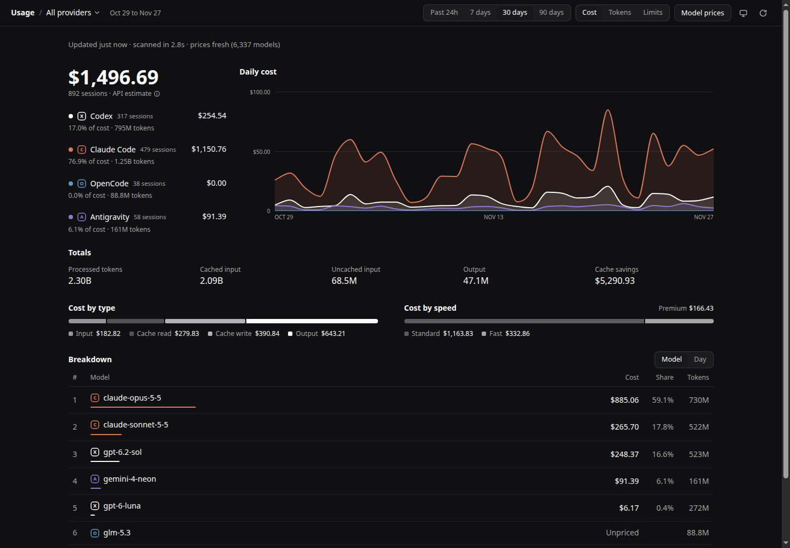
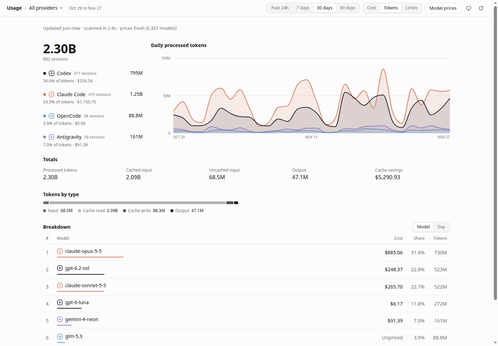
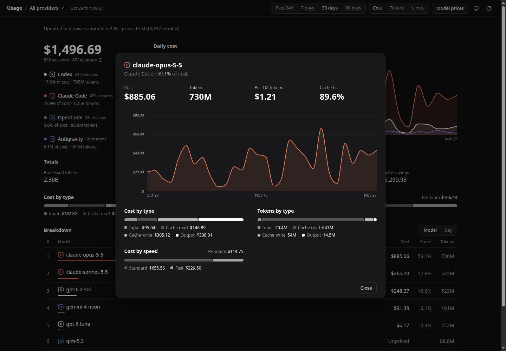
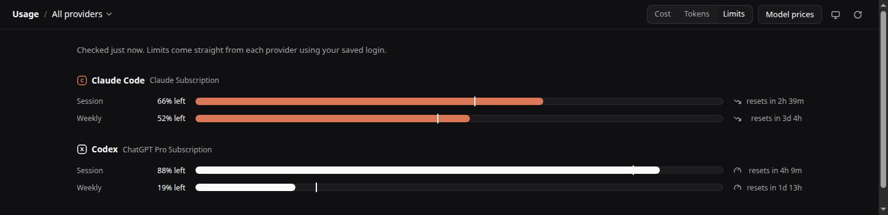

# Usage Tracker

See what your coding agents cost, how many tokens they burn, and how much of your plan is left.

Usage Tracker reads the transcripts that Claude Code, Codex, OpenCode, Grok Build, Antigravity and Pi already write to disk, prices them against public list prices, and shows the result on one local page. It is a standalone port of the Usage page in [T3 Code](https://github.com/pingdotgg/t3code), so you get the same view without running T3 Code. It needs Python 3.10+ and a browser, and installs nothing.



<sub>All screenshots show synthetic data generated by `scripts/demo_data.py`.</sub>

## Quick start

```bash
git clone https://github.com/escoffier-labs/usage-tracker.git
cd usage-tracker
python3 bin/usage_tracker.py
```

That reads your local history, prices it, serves the page on `http://127.0.0.1:5200/` (this machine only), and opens your browser. The first run over a large history can take a minute. Later runs reuse a per-file scan cache. The Refresh button in the page scans again.

| Flag | Effect |
| --- | --- |
| `--port 0` | Pick a free port |
| `--no-browser` | Do not open a window |
| `--no-export` | Serve the last export as is |
| `--no-limits` | Never contact Claude or Codex for limits |
| `--offline` | Use cached prices only |
| `--days N` | History length (default 90) |

To write the data file without serving anything, run `python3 bin/export_usage.py` (it writes `data/usage.json`, and `--help` lists the options).

## The page

### Cost

The default tab. Cost is an **API-rate estimate**: what the same requests would cost at list prices, not what a subscription charged you. Pick a period (past 24 hours hourly, or 7, 30 or 90 days), filter to one provider, and hover the chart for a per-day split. Below the chart are totals, cost by token type, and cost by speed, which shows the fast or priority premium where a provider bills one. Models with no known price show as **Unpriced**, never as zero.

### Tokens

The same layout in tokens: processed, cached and uncached input, output, and cache savings, with the model table sorted by tokens instead of cost.



### Per-model detail

Click any model in the breakdown for its own trend, cost and token mix, cache hit rate and cost per million tokens.



### Limits

Remaining quota for Claude Code and Codex, read with the login those tools already saved. The tick on each bar is the even-spending pace for the window, so a bar that ends left of its tick means you are using quota faster than the window refills. The icon beside each reset time says whether you are ahead of, on, or under pace.



### Also on the page

- **Model prices**: set your own per-million-token price for any model, for example one the price table does not know. Stored in this browser's `localStorage` and applied in the page.
- Data freshness, price status, and a warning for every source that could not be read in full (under **Sources**).
- Keyboard: `C`, `T`, `L` switch tab, and `1` to `4` (or `Ctrl`/`Cmd` + `Shift` + `1` to `4`) switch period. Light and dark follow your system, with a toggle.

## Where the data comes from

Missing folders are skipped silently. Locations and parsing rules match T3 Code's readers, including de-duplication of repeated records.

| Provider | Location | Notes |
| --- | --- | --- |
| Claude Code | `~/.claude/projects/**/*.jsonl` (or `$CLAUDE_CONFIG_DIR`) | One request per message even though Claude writes a line per content block. Advisor-model calls are billed to their own model. Fast mode is priced as fast. |
| Codex | `~/.codex/sessions/**/*.jsonl[.zst]` (or `$CODEX_HOME`) | Cumulative counters validate each request. Forked and copied rollouts are not billed twice. `.zst` files need Python 3.14 or the `zstd` command. |
| OpenCode | `~/.local/share/opencode` (`opencode*.db`, legacy `storage/message`) | Honors `OPENCODE_DATA_DIR` and `XDG_DATA_HOME`. |
| Grok Build | `~/.grok/sessions/**/updates.jsonl` (or `$GROK_HOME`) | Uses the cost Grok reports per model. |
| Antigravity | `~/.gemini/antigravity*` and `~/.config/antigravity` conversation databases | Decodes the protobuf usage rows. `$ANTIGRAVITY_DATA_DIR` overrides. |
| Pi | `~/.pi/agent/sessions` (or `$PI_CODING_AGENT_SESSION_DIR`) | |

Not ported from T3 Code: Cursor and Muse, and T3's own database lookup that resolves some older Codex service tiers (those requests are billed as standard).

**Prices** come from [LiteLLM's model price table](https://github.com/BerriAI/litellm), fetched once a day and cached in your user cache directory (`~/.cache/usage-tracker` on Linux). Offline, the cached copy is used. With no cache at all, costs show as unknown.

**Scan cache.** Parsed Claude, Codex, Grok and Pi transcripts are cached per file in the same directory (`usage-scan-cache-v1.json`, ported from T3 Code's scan cache). A file is reused while its size, mtime and inode are unchanged. A changed file is parsed again whole, and entries for deleted files are dropped. The cache holds token counts, model names, session ids and timestamps, never prompts, message text or credentials. Cost is computed after the cache, so price changes and overrides still apply, and a warm export matches a cold one byte for byte. On one machine with about 5,700 transcripts a 30 day export went from 45 s to 3 s. `--no-cache` on `bin/export_usage.py` ignores it.

**Limits** use Claude Code's OAuth token (`~/.claude/.credentials.json`, or the macOS Keychain item `Claude Code-credentials`) and the ChatGPT token in `~/.codex/auth.json`. If you are not signed in to one of them, it is not shown.

## Privacy

- The server binds to `127.0.0.1` only, serves just the page and the data file, rejects requests whose `Host` is not loopback, and requires a custom header on the refresh endpoint.
- Login tokens are read into memory, sent only over HTTPS to Anthropic (`api.anthropic.com`) and OpenAI (`chatgpt.com`) respectively, never follow a redirect, and are never written to `data/usage.json`, logs or error messages.
- The only other request is the public LiteLLM price table. Transcripts and prompts never leave your machine, and the page loads no CDN or font.
- `data/usage.json` and `data/fleet-usage.json` are git-ignored and written with mode `0600`. They hold token counts, costs and model names, not conversation text or session ids.

## Several machines (optional)

Single-machine use never needs this. To merge usage from more than one machine, `bin/collect_fleet_usage.py` runs the exporter on each machine in `config/fleet.json` (this one, or any SSH alias that has Python 3.10+, with nothing installed remotely) and writes `data/fleet-usage.json` with a machine dimension and each machine's limits. The format is in [docs/fleet-usage-schema.md](docs/fleet-usage-schema.md). The systemd units run it every five minutes:

```bash
python3 bin/collect_fleet_usage.py            # one collection, uses config/fleet.json
systemctl --user link "$PWD/systemd/usage-tracker-fleet.service" "$PWD/systemd/usage-tracker-fleet.timer"
systemctl --user enable --now usage-tracker-fleet.timer
```

## Development

```bash
python -m pytest tests/ -q
python scripts/check_frontend.py index.html
node tests/frontend.test.js
python scripts/scan_repo.py .
```

Python 3 is the only runtime dependency. Tests use `pytest`, and the page-logic check uses Node. See [AGENTS.md](AGENTS.md) for the architecture.

To refresh the README screenshots, serve the synthetic data instead of your own:

```bash
python3 scripts/demo_data.py                  # writes a seeded data/usage.json
python3 bin/usage_tracker.py --no-export --no-limits
```

Capture at 1440 px wide into `docs/assets/screenshots/`, then rerun `bin/export_usage.py` to restore your real data.

## Credits and license

The design, layout and logic are ported from the Usage page of [T3 Code](https://github.com/pingdotgg/t3code) (MIT, Copyright (c) 2026 T3 Tools Inc.). See [NOTICE](NOTICE) for what was ported and the license text.

MIT. See [LICENSE](LICENSE).
